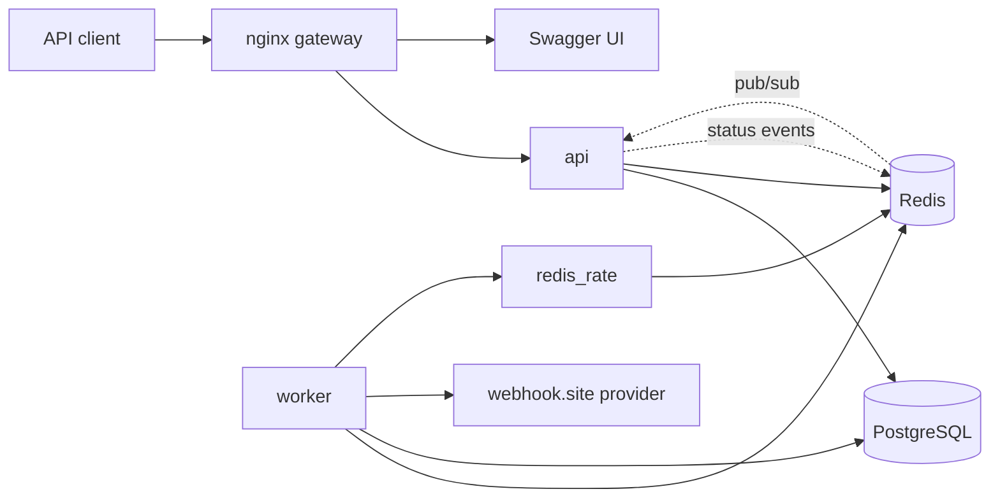

# Insider One — Event-Driven Notification System

A production-shaped notification service that accepts SMS, email, and push requests, processes them asynchronously, delivers them through a simulated provider, and exposes status, metrics, and logs.

Built for the **Insider One Software Engineer Assessment 2026** with **Go 1.26**, **PostgreSQL 16**, and **Redis 7**.

> **Status:** all MVP requirements and bonus features are implemented: scheduled notifications, templates, WebSocket status updates, distributed tracing, dead-letter retry, a k6 load test, and a Prometheus/Grafana profile.

## What it does

- Create one notification or a batch of up to 1000.
- Render reusable templates with `{{variable}}` substitution, or send inline content.
- Query by notification ID or batch ID. List with status, channel, batch, and date filters plus pagination.
- Cancel pending or scheduled notifications. Retry failed or dead-letter notifications.
- Process asynchronously with weighted priority queues, a shared 100 messages/second limit per channel, retries, and dead-letter handling.
- Reduce duplicate sends with API idempotency keys, unique task IDs, and guarded state transitions. The delivery contract remains at-least-once.
- Deliver through webhook.site, with `202 accepted` treated as provider acceptance.
- Stream status changes over WebSocket and propagate a W3C trace through API, queue, worker, and provider.
- Expose Prometheus metrics, JSON logs with correlation IDs, health checks, and a human-readable stats endpoint.

## Architecture



The API and worker are two processes from the same codebase. PostgreSQL is the source of truth; Redis holds the queue, rate limiter, and pub/sub state. This is a modular monolith, not a microservice fleet.

The worker waits for a channel token before claiming a row, so the processing lease only covers the provider call. A guarded claim accepts `pending`, `queued`, a due `scheduled`, or a stale `processing` row. A reconciler re-enqueues pending rows, due scheduled rows, and queued rows that have not advanced for 15 minutes.

See [docs/architecture.md](docs/architecture.md) for the full design and [docs/decisions/](docs/decisions/) for the trade-offs.

## Design highlights

| Area | Decision |
| --- | --- |
| Architecture | Modular monolith with `api`, `worker`, and `migrate` commands. |
| Queue | asynq on Redis with weighted `high`, `normal`, `low` queues. |
| Rate limiting | `redis_rate` GCRA, 100 requests/second per channel, burst 1, shared across replicas. |
| Delivery | At-least-once with exponential backoff, jitter, `Retry-After`, and a dead-letter state. |
| Idempotency | API `Idempotency-Key` plus worker task IDs and guarded transitions. |
| Recovery | A reconciler sweeps pending, due scheduled, and stale queued rows after a crash or a Redis outage. |
| Scheduling | `scheduled_at` uses asynq `ProcessAt`; cancellation is checked when the task fires. |
| Templates | `templates` table, `{{variable}}` rendering, missing variables rejected before enqueue. |
| Realtime | Redis pub/sub to a WebSocket hub; clients get a snapshot, then live status frames. |
| Tracing | OpenTelemetry OTLP spans; `traceparent` travels in the asynq payload and the provider request. |
| Observability | Prometheus metrics, JSON logs, `X-Request-ID`, `/healthz`, `/readyz`, `/api/v1/stats`. |
| API contract | OpenAPI 3.1, Swagger UI, and Redocly lint in CI. |
| Delivery simulation | webhook.site; tests use a local `httptest` provider. |

## Quickstart

```bash
git clone https://github.com/onatozmenn/insider-one-notification-system.git
cd insider-one-notification-system
cp .env.example .env
docker compose up --build
```

Optional profiles:

```bash
# Jaeger for traces (set OTEL_EXPORTER_OTLP_ENDPOINT=http://jaeger:4318 in .env first)
docker compose --profile tracing up -d jaeger

# Prometheus and Grafana
docker compose --profile metrics up -d prometheus grafana
```

Restart the API and worker after changing `OTEL_EXPORTER_OTLP_ENDPOINT` so the exporter picks it up.

Before expecting delivery, replace `PROVIDER_BASE_URL` in `.env` with your own URL from [webhook.site](https://webhook.site). Configure it to return:

- Status: `202`
- Content type: `application/json`
- Body:

```json
{
  "messageId": "3f2b9c1e-8a4d-4f6e-9b2a-1c7d5e8f0a3b",
  "status": "accepted",
  "timestamp": "2026-11-17T19:00:00Z"
}
```

The URL is public and anonymous webhook.site URLs expire after seven days. If port `8080` is already in use, set `GATEWAY_PORT=8090` in `.env` and replace `8080` with `8090` below.

| URL | What |
| --- | --- |
| `http://localhost:8080/docs` | Swagger UI |
| `http://localhost:8080/openapi.yaml` | OpenAPI 3.1 spec |
| `http://localhost:8080/api/v1/stats` | Queue depth, success rate, p95 |
| `http://localhost:8080/metrics` | API Prometheus metrics |
| `http://localhost:9091/metrics` | Worker Prometheus metrics |
| `http://localhost:8080/healthz` | Liveness |
| `http://localhost:8080/readyz` | PostgreSQL and Redis readiness |
| `ws://localhost:8080/api/v1/ws?notification_id=<id>` | Live status updates |
| `http://localhost:16686` | Jaeger UI (`tracing` profile) |
| `http://localhost:9090` | Prometheus (`metrics` profile) |
| `http://localhost:3000` | Grafana, `admin` / `admin` (`metrics` profile) |

## API examples

Create a notification:

```bash
curl -s -X POST http://localhost:8080/api/v1/notifications \
  -H 'Content-Type: application/json' \
  -H 'Idempotency-Key: demo-001' \
  -d '{
    "recipient": "+15555550100",
    "channel": "sms",
    "content": "Your order has shipped.",
    "priority": "high"
  }'
```

Create a batch:

```bash
curl -s -X POST http://localhost:8080/api/v1/notifications/batch \
  -H 'Content-Type: application/json' \
  -d '{
    "notifications": [
      {"recipient": "+15555550100", "channel": "sms", "content": "Flash sale starts now.", "priority": "high"},
      {"recipient": "onat@example.com", "channel": "email", "subject": "Weekly summary", "content": "Here is what happened.", "priority": "normal"}
    ]
  }'
```

Check status:

```bash
export NOTIFICATION_ID="<notification-id>"
export BATCH_ID="<batch-id>"

curl -s "http://localhost:8080/api/v1/notifications/${NOTIFICATION_ID}"
curl -s "http://localhost:8080/api/v1/batches/${BATCH_ID}"
curl -s 'http://localhost:8080/api/v1/notifications?status=accepted&channel=sms&page=1&page_size=20'
```

Cancel a pending or scheduled notification:

```bash
curl -s -X POST "http://localhost:8080/api/v1/notifications/${NOTIFICATION_ID}/cancel"
```

Create a template and send with it:

```bash
curl -s -X POST http://localhost:8080/api/v1/templates \
  -H 'Content-Type: application/json' \
  -d '{
    "name": "welcome",
    "channel": "sms",
    "content": "Hello {{name}}, your code is {{code}}"
  }'

curl -s -X POST http://localhost:8080/api/v1/notifications \
  -H 'Content-Type: application/json' \
  -d '{
    "recipient": "+15555550100",
    "channel": "sms",
    "template": "welcome",
    "variables": {"name": "Onat", "code": "ABC"}
  }'
```

Retry a failed or dead-letter notification:

```bash
curl -s -X POST "http://localhost:8080/api/v1/notifications/${NOTIFICATION_ID}/retry"
```

Watch status changes over WebSocket (the first frame is a snapshot):

```bash
websocat "ws://localhost:8080/api/v1/ws?notification_id=${NOTIFICATION_ID}"
```

```json
{"type":"snapshot","notification":{"id":"...","status":"queued"}}
{"type":"status","event":{"notification_id":"...","status":"processing","attempt_count":1}}
{"type":"status","event":{"notification_id":"...","status":"accepted","attempt_count":1}}
```

Schedule a notification:

```bash
curl -s -X POST http://localhost:8080/api/v1/notifications \
  -H 'Content-Type: application/json' \
  -d '{
    "recipient": "+15555550100",
    "channel": "sms",
    "content": "This is scheduled.",
    "scheduled_at": "2026-11-18T10:00:00Z"
  }'
```

Inspect stats:

```bash
curl -s http://localhost:8080/api/v1/stats
```

```json
{
  "queue_depth": {"high": 0, "normal": 2, "low": 0},
  "window": "5m",
  "counts": {"accepted": 3, "failed": 0, "dead_letter": 0},
  "success_rate": 1,
  "p95_latency_ms": 1198
}
```

## Delivery behavior

- **Priority:** `high` 6, `normal` 3, `low` 1. Low-priority work is delayed, not starved.
- **Rate limit:** 100 provider calls per second per channel, shared through Redis. The token wait happens before the claim.
- **Retries:** up to 5 provider attempts by default. Exponential backoff with full jitter, capped at 30 seconds. `Retry-After` is honoured.
- **Infrastructure retries:** Redis/database failures use a separate asynq transport retry budget (100) and do not consume provider attempts.
- **Error classes:** `408`, `425`, `429`, `5xx`, timeouts, and network errors are transient. Other `4xx` are permanent.
- **Dead letter:** exhausted transient retries move to `dead_letter` with the last error and attempt count. `POST /notifications/{id}/retry` resets the row, uses a fresh task ID, and re-enqueues it.
- **Templates:** the API renders the template before validation. A missing variable rejects the request with `variables.<name>` details. The stored notification keeps the rendered content.
- **Idempotency:** the API stores a key and request hash and replays the original resource. Keys expire after 24 hours; expired rows are deleted on read and by an hourly cleanup, so the key can be reused. The worker uses the notification ID as the task ID and guards every transition.
- **Cancellation:** only `pending` and `scheduled`; the worker re-checks before the provider call.
- **Recovery:** a reconciler every 30 seconds re-enqueues pending rows, due scheduled rows, and queued rows that have not advanced for 15 minutes. Archived tasks that still own the ID are removed and re-enqueued. A stale `processing` row can be reclaimed after the lease; if it already used every attempt, it moves to `dead_letter`.

## Testing

```bash
make test           # unit + integration + coverage (Docker required for integration)
make test-unit      # unit and contract tests with the race detector
make test-integration # real PostgreSQL and Redis
make coverage       # domain coverage report
make smoke          # end-to-end check against the running stack
make openapi-lint   # Redocly lint for the OpenAPI spec
make load-test      # k6 create throughput, requires k6 and a running stack
```

The suite covers validation, idempotency and service rules, templates and rendering, API handlers, WebSocket frames, provider responses (202, 400, 429, 500, timeout), worker transitions, retry backoff, priority mapping, tracing endpoint handling, repository transitions, job queueing, the reconciler, and Redis pub/sub. Provider tests use `httptest` and do not depend on webhook.site.

Integration tests use testcontainers locally and GitHub Actions service containers in CI. Current coverage is 76.1% for `internal/notification` and 73.5% for `internal/delivery`. The manual end-to-end checks below were run against the Compose stack and the bonus features were exercised the same way.

## Verified end-to-end

On 2026-11-18, against the local Compose stack and webhook.site:

- Single notification: `202` with `queued`, then `accepted` with attempt 1 and a provider message ID.
- Batch of three: `processing` with queued counts, then all three accepted.
- Failure path with a webhook returning `500`: retries were logged and the notification reached `dead_letter` after 3 attempts with `provider returned 500`.
- Scheduled notification: started as `scheduled`, then `accepted` after the scheduled time.
- Scheduled cancellation: cancelled before the scheduled time and remained `cancelled` with no provider message ID.
- Reconciler: recovered six pre-existing `pending` rows and queued them.
- Metrics: API and worker `/metrics` exposed HTTP, queue-depth, provider, status, rate-limit, and processing metrics.
- Stats: `accepted: 3`, `success_rate: 1`, `p95_latency_ms: 1198`.
- Template: `welcome` rendered `Hello Onat, your code is ABC` and the notification reached `accepted`.
- Dead-letter retry: `dead_letter` → `POST /retry` → `queued` → `accepted`, attempts reset to 1.
- WebSocket: snapshot `scheduled`, then `processing`, then `accepted` frames.
- Tracing: one Jaeger trace contained `POST /api/v1/notifications`, `queue.enqueue`, `notification.process`, and `provider.send`.
- k6 smoke (5 VUs, 5 seconds): 2027 creates, 0% failed, p95 15.1 ms.
- k6 burst (20 VUs, 5 seconds): 4468 creates, 0% failed, p95 27.9 ms.
- Under that burst, Prometheus showed 15.5 SMS provider calls/s with a 4468-deep queue: below the 100/s per-channel cap, with provider latency as the bottleneck.
- Prometheus targets for API and worker were `up`; Grafana loaded the provisioned dashboard and datasource.
- `make smoke`: one notification and a batch of three reached `accepted`; `/stats` returned counts.
- Recovery regression tests: due scheduled and stale queued rows were re-enqueued; an archived task was removed and re-enqueued; a stale processing row at `max_attempts` moved to `dead_letter`; an expired idempotency key was deleted and reused.
- CI: unit, integration, coverage, lint, Docker build, and OpenAPI lint passed.

## Documentation

| Document | What it covers |
| --- | --- |
| [AGENTS.md](AGENTS.md) | Project constitution, scope, stack, definition of done. |
| [docs/architecture.md](docs/architecture.md) | Components, flows, scaling, trade-offs. |
| [docs/domain-model.md](docs/domain-model.md) | Schema, statuses, transitions, indexes. |
| [docs/api.md](docs/api.md) | Endpoints, examples, errors, idempotency. |
| [docs/reliability.md](docs/reliability.md) | Queue, rate limiting, retries, failure handling. |
| [docs/observability.md](docs/observability.md) | Metrics, logs, health, tracing, WebSocket. |
| [docs/testing.md](docs/testing.md) | Test strategy and commands. |
| [docs/operations.md](docs/operations.md) | Compose, configuration, migrations, runbook. |
| [docs/roadmap.md](docs/roadmap.md) | Milestones, issues, commit plan. |
| [docs/demo.md](docs/demo.md) | A step-by-step demo with expected results. |

## Limitations

- At-least-once delivery, not exactly-once.
- No authentication or multi-tenancy; the API is intended for a local demo.
- webhook.site is a simulation. `accepted` means the provider accepted the message, not that a user received it.
- A Redis flush loses queued tasks; the reconciler recovers pending, due scheduled, and stale queued rows after 15 minutes. In-flight provider calls can still be duplicated.
- Offset pagination can shift when new rows arrive during a scan.
- WebSocket updates are best-effort. A client that misses a frame can re-read the notification; there is no replay buffer.
