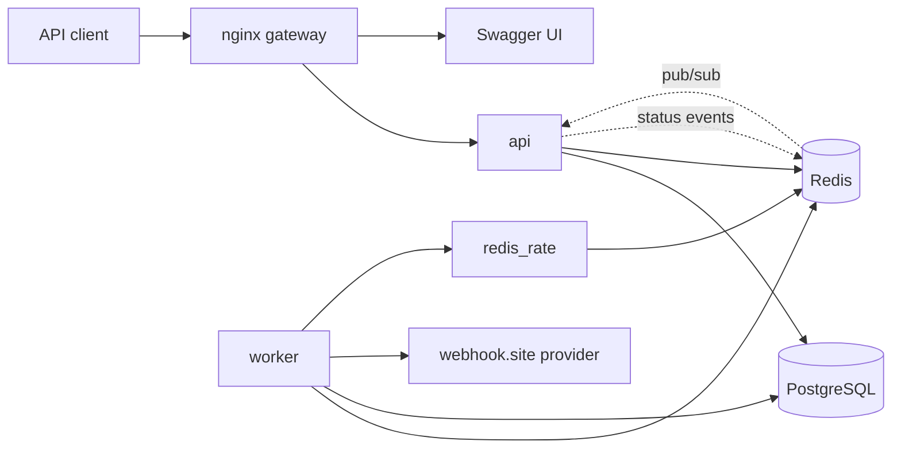

# Insider One — Event-Driven Notification System

A scalable notification service that accepts SMS, email, and push requests, processes them asynchronously, delivers them through a simulated provider, and exposes status, metrics, and logs.

Built for the **Insider One Software Engineer Assessment 2026** in Go, PostgreSQL, and Redis.

> **Status:** the core MVP is running. The API, PostgreSQL schema, Redis queue, worker, provider calls, retries, and dead-letter handling are implemented. Observability, OpenAPI, and the bonus features are in progress. The architecture and contracts are in [`docs/`](docs/).

## What it does

- Create one notification or a batch of up to 1000.
- Query by notification ID or batch ID. List with status, channel, and date filters plus pagination.
- Cancel pending or scheduled notifications.
- Process asynchronously with priority queues, 100 messages/second per channel, retries, backoff, and dead letters.
- Reduce duplicate sends with idempotency keys and guarded state transitions. The delivery contract remains at-least-once.
- Expose Prometheus metrics, structured logs with correlation IDs, health checks, and a human-readable stats endpoint.

## Architecture



The API and worker are two processes from the same codebase. PostgreSQL is the source of truth; Redis holds the queue, rate limiter, and pub/sub state. This is a modular monolith, not a microservice fleet. See [docs/architecture.md](docs/architecture.md) for the full picture and [docs/decisions/](docs/decisions/) for the trade-offs.

## Design highlights

| Area | Decision |
| --- | --- |
| Architecture | Modular monolith with `api`, `worker`, and `migrate` commands. |
| Queue | asynq on Redis with weighted `high`, `normal`, `low` queues. |
| Rate limiting | `redis_rate` GCRA, 100 requests/second per channel, shared across replicas. |
| Delivery | At-least-once with exponential backoff, jitter, and a dead-letter state. |
| Idempotency | API `Idempotency-Key` plus worker task IDs and guarded transitions. |
| Recovery | A reconciler re-enqueues `pending` rows after a crash or a short Redis outage. |
| Observability | Prometheus metrics, JSON logs, `X-Request-ID`, `/healthz`, `/readyz`, `/api/v1/stats`. |
| Delivery simulation | webhook.site; tests use a local `httptest` provider. |

## Quickstart

```bash
git clone https://github.com/onatozmenn/insider-one-notification-system.git
cd insider-one-notification-system
cp .env.example .env
docker compose up --build
```

If port `8080` is already in use, set `GATEWAY_PORT=8090` in `.env` and replace `8080` with `8090` below.

The stack exposes:

| URL | What |
| --- | --- |
| `http://localhost:8080/docs` | Swagger UI |
| `http://localhost:8080/api/v1/stats` | Queue depth, success rate, p95 |
| `http://localhost:8080/metrics` | API Prometheus metrics |
| `http://localhost:9091/metrics` | Worker Prometheus metrics |
| `http://localhost:8080/healthz` | Liveness |
| `http://localhost:8080/readyz` | PostgreSQL and Redis readiness |

The `PROVIDER_BASE_URL` in `.env.example` is a placeholder. Create your own URL at webhook.site, configure it to return `202` with the provider response body, and replace the value before running the demo. The URL is public and anonymous URLs expire after seven days.

## API examples

Create a notification:

```bash
curl -s -X POST http://localhost:8080/api/v1/notifications \
  -H 'Content-Type: application/json' \
  -H 'Idempotency-Key: demo-001' \
  -d '{
    "recipient": "+15555550100",
    "channel": "sms",
    "content": "Your order has shipped.",
    "priority": "high"
  }'
```

Create a batch:

```bash
curl -s -X POST http://localhost:8080/api/v1/notifications/batch \
  -H 'Content-Type: application/json' \
  -d '{
    "notifications": [
      {"recipient": "+15555550100", "channel": "sms", "content": "Flash sale starts now.", "priority": "high"},
      {"recipient": "onat@example.com", "channel": "email", "subject": "Weekly summary", "content": "Here is what happened.", "priority": "normal"}
    ]
  }'
```

Check status:

```bash
export NOTIFICATION_ID="<notification-id>"
export BATCH_ID="<batch-id>"

curl -s "http://localhost:8080/api/v1/notifications/${NOTIFICATION_ID}"
curl -s "http://localhost:8080/api/v1/batches/${BATCH_ID}"
curl -s 'http://localhost:8080/api/v1/notifications?status=accepted&channel=sms&page=1&page_size=20'
```

Cancel a pending notification:

```bash
curl -s -X POST "http://localhost:8080/api/v1/notifications/${NOTIFICATION_ID}/cancel"
```

## Testing

```bash
make test          # unit tests with the race detector
make test-unit
```

The integration and smoke profiles are still in progress. Provider tests use a local `httptest` server and do not depend on webhook.site.

The integration tests use real PostgreSQL and Redis via testcontainers locally and service containers in CI. The provider tests use `httptest`; they do not depend on webhook.site.

## Documentation

| Document | What it covers |
| --- | --- |
| [AGENTS.md](AGENTS.md) | Project constitution, scope, stack, definition of done. |
| [docs/architecture.md](docs/architecture.md) | Components, flows, scaling, trade-offs. |
| [docs/domain-model.md](docs/domain-model.md) | Schema, statuses, transitions, indexes. |
| [docs/api.md](docs/api.md) | Endpoints, examples, errors, idempotency. |
| [docs/reliability.md](docs/reliability.md) | Queue, rate limiting, retries, failure handling. |
| [docs/observability.md](docs/observability.md) | Metrics, logs, health, tracing, WebSocket. |
| [docs/testing.md](docs/testing.md) | Test strategy and commands. |
| [docs/operations.md](docs/operations.md) | Compose, configuration, migrations, runbook. |
| [docs/roadmap.md](docs/roadmap.md) | Milestones, issues, commit plan. |

## Limitations

- At-least-once delivery, not exactly-once.
- No authentication or multi-tenancy; the API is intended for a local demo.
- webhook.site is a simulation, not a real provider. `accepted` means the provider accepted the message, not that a user received it.
- A Redis flush loses queued tasks. The reconciler recovers `pending` rows, not in-flight tasks.
- Offset pagination can shift when new rows arrive during a scan.
