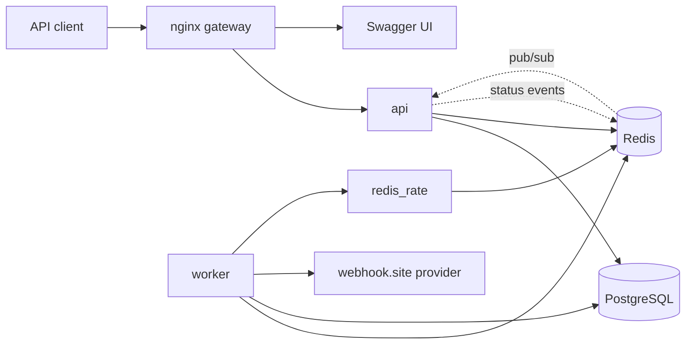
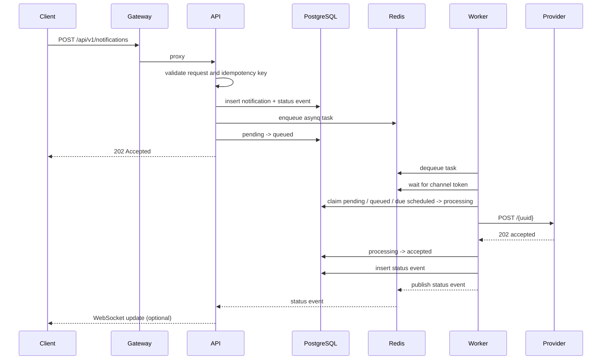

# Architecture

## 1. Goals

- Accept notification requests without waiting for delivery.
- Deliver through a simulated provider with bounded, observable retries.
- Keep provider traffic at or below 100 requests per second per channel.
- Survive restarts without losing accepted work.
- Keep the system small enough to run with one command and easy enough to review in a few hours.

## 2. Constraints

- One public Go repository.
- `docker compose up` starts the whole stack.
- PostgreSQL is the source of truth. Redis holds disposable infrastructure state.
- No microservices, Kubernetes, or service mesh.
- Assessment scope: the core must be correct before any bonus feature.

The full rule set is in [AGENTS.md](../AGENTS.md).

## 3. System context

The client only talks to the gateway. The gateway routes API calls, health checks, metrics, OpenAPI docs, and WebSocket connections.

## 4. Runtime topology

| Service | Image | Responsibility | Exposed |
| --- | --- | --- | --- |
| `gateway` | `nginx:alpine` | Single entry point, reverse proxy, WebSocket upgrade, static docs route | `8080` |
| `api` | project image, `api` command | HTTP API, validation, persistence, enqueue, queries, metrics, WebSocket hub | `8081` for debugging |
| `worker` | project image, `worker` command | Queue consumer, rate limiting, provider calls, retries, status updates | none |
| `migrate` | project image, `migrate` command | Runs versioned SQL migrations once | none |
| `postgres` | `postgres:16-alpine` | Source of truth | internal |
| `redis` | `redis:7-alpine` | asynq queues, rate limiter, pub/sub | internal |
| `swagger-ui` | `swaggerapi/swagger-ui` | Serves `api/openapi.yaml` | internal, via `/docs` |

The API and worker share one image and one codebase. They run as separate processes so that intake and delivery can scale independently.

Optional profiles:

- `tools`: asynqmon for queue inspection.
- `tracing`: Jaeger all-in-one for OTLP traces.
- `metrics`: Prometheus and Grafana.

## 5. Request flow

### Single notification

### Batch notification

1. Validate all items. One invalid item rejects the whole batch with item-level errors.
2. Insert the batch row and up to 1000 notification rows in one transaction.
3. After commit, enqueue each notification.
4. Return `202 Accepted` with the batch ID and a status URL.

If the process dies after commit and before all tasks are enqueued, the reconciler finds `pending` rows older than one minute and enqueues them. This is the same recovery path used for a Redis outage.

The enqueue and the `pending` to `queued` update are not atomic. A worker can dequeue the task before the API writes `queued`, so the worker claim accepts both `pending` and `queued`. This closes the race without a transactional outbox.

The protocol is:

- API commits `pending`, enqueues, then updates to `queued`.
- Worker claim accepts `pending` or `queued`. A task that arrives before the `queued` update is claimed from `pending`.
- Reconciler scans `pending` older than one minute. It does not scan `queued`, because a queued row should have a Redis task.
- Claim also accepts a due `scheduled` row and a stale `processing` row.

A `processing` row is owned by the worker until it writes a retry or terminal state. The claim increments `attempt_count` and refreshes `updated_at`. If the worker dies, `updated_at` stops advancing; after a 2-minute lease a retried task can reclaim the row. The lease is longer than the provider timeout.

## 6. Module boundaries

| Package | Owns | May import |
| --- | --- | --- |
| `internal/notification` | Domain types, validation, state machine, repository interfaces, application service | standard library; interfaces it declares itself |
| `internal/delivery` | Enqueue, worker, priority, rate limiter, retry policy | `notification`, `provider`, `platform` |
| `internal/provider` | HTTP provider adapter, error classification, test double | standard library |
| `internal/realtime` | WebSocket hub, Redis pub/sub status events | standard library, Redis client |
| `internal/platform` | Config, logging, metrics, PostgreSQL, Redis, tracing, HTTP server, shutdown | infrastructure libraries |

Rules:

- The domain does not import HTTP, Redis, or SQL packages.
- Adapters implement interfaces declared by the consumer.
- Cross-module access goes through exported services or interfaces, never through another module's tables.
- `platform` contains no business rules.

## 7. Data ownership

**PostgreSQL** owns:

- Notification and batch records.
- Status history.
- Idempotency records.
- Templates.

**Redis** owns:

- asynq queues and scheduled tasks.
- Rate limiter state.
- Pub/sub channels for WebSocket updates.

Redis is treated as disposable. If it is flushed, the reconciler re-enqueues `pending` work, but tasks that were already `queued` in Redis are lost. This is an accepted trade-off for the assessment; a production system would use a durable outbox or a queue with stronger persistence guarantees.

## 8. Scaling model

- **API:** stateless. Add replicas behind the gateway.
- **Worker:** stateless. Add replicas; asynq distributes tasks and `redis_rate` shares the per-channel limit.
- **PostgreSQL:** single primary. Indexes cover the list and status queries. Read replicas are a future concern.
- **Redis:** single instance for the assessment. Production would use a managed Redis with persistence and replicas.
- **Priority:** asynq queues are weighted (`high` 6, `normal` 3, `low` 1) so low-priority work is delayed, not starved.

## 9. Failure isolation

| Failure | Effect | Recovery |
| --- | --- | --- |
| Provider is down or slow | Worker retries with backoff; queue depth grows | Provider recovers; tasks drain |
| Provider returns a non-retryable 4xx | Notification moves to `failed` | Operator fixes payload or recipient |
| Retries exhausted | Notification moves to `dead_letter` | Inspect, fix, then `POST /api/v1/notifications/{id}/retry` |
| Redis is down | API can persist but cannot enqueue; readiness fails | Redis returns; reconciler enqueues pending rows |
| PostgreSQL is down | API returns 503; worker cannot update state | PostgreSQL returns; in-flight tasks retry |
| Worker crashes mid-call | Task is retried; provider may see a duplicate | DB state guard and provider idempotency header |
| API crashes after commit | Notification stays `pending` | Reconciler enqueues it |

## 10. Trade-offs

- **Modular monolith, not microservices.** The assessment values correct design, not distributed-system overhead. Module boundaries keep the option to split later.
- **At-least-once, not exactly-once.** Exactly-once delivery across a provider boundary is not realistic. We use idempotency keys and state guards to make duplicates unlikely and harmless.
- **asynq, not Kafka or RabbitMQ.** asynq gives priority queues, retries, scheduling, and unique tasks with a small operational footprint. Kafka would add a broker and a new programming model for no benefit at this scale.
- **PostgreSQL plus Redis, not an outbox.** A transactional outbox is the stronger pattern, but it adds a dispatcher and another table. The reconciler covers the failure window with much less code. This is documented as a deliberate trade-off.
- **Offset pagination, not cursors.** Easier for reviewers and API consumers. The list is ordered by `created_at DESC, id DESC` for stable pages.

## 11. Non-goals

- Authentication and multi-tenancy.
- Real SMS, email, or push providers.
- A custom queue or scheduler.
- A frontend dashboard.
- Cross-region replication.
- Exactly-once delivery.

See [AGENTS.md](../AGENTS.md) for the full scope.
