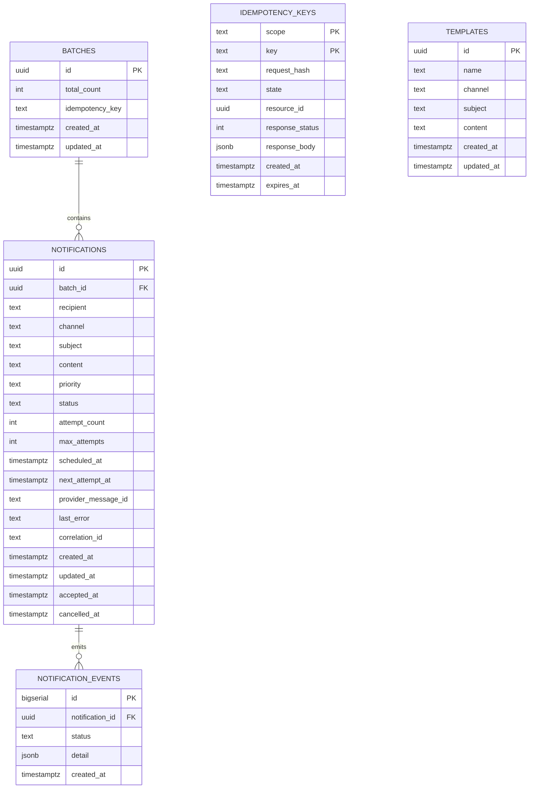
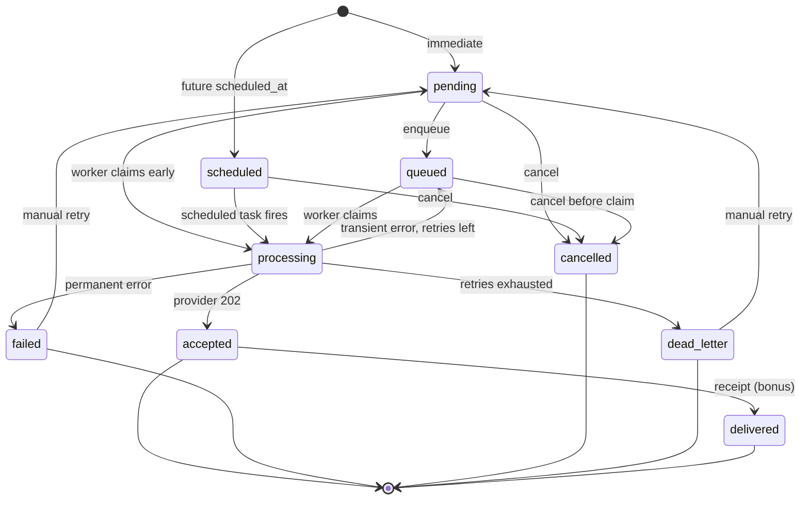

# Domain Model

## 1. Entities



`TEMPLATES` is created by migration `000002_templates`. A notification stores the rendered body; the template reference is not persisted.

## 2. Notification statuses

| Status | Meaning | Terminal |
| --- | --- | --- |
| `pending` | Created and committed, not yet enqueued. | No |
| `scheduled` | Waiting for `scheduled_at`. | No |
| `queued` | In Redis, waiting for a worker. | No |
| `processing` | Claimed by a worker, provider call in progress. | No |
| `accepted` | Provider returned 202. | Yes, unless delivery receipts are enabled. |
| `failed` | Permanent error. | Yes |
| `cancelled` | Cancelled before processing. | Yes |
| `dead_letter` | Retries exhausted. Needs attention. | Yes |
| `delivered` | Delivery receipt received. Bonus. | Yes |

`accepted` means the provider accepted the message. We do not claim delivery without a receipt.

## 3. State machine



Every transition is a guarded update:

```sql
UPDATE notifications
SET status = 'processing', updated_at = now()
WHERE id = $1 AND status = 'queued'
RETURNING *;
```

If zero rows change, the worker stops. Another worker or a cancellation already moved the row.

A `processing` row can be reclaimed after its lease expires. The guarded update adds `OR (status = 'processing' AND updated_at < now() - interval '2 minutes' AND attempt_count < max_attempts)`. If every attempt is already used, the worker moves the row to `dead_letter` instead of reclaiming it. This recovers a worker crash without exceeding `attempt_count <= max_attempts`.

A `queued` row can be cancelled while it waits in Redis. The guarded update and the worker claim race on the same row; whichever wins decides whether the notification is cancelled or delivered.

## 4. Tables

### `notifications`

| Column | Type | Notes |
| --- | --- | --- |
| `id` | `uuid` | UUIDv7, generated by the server. |
| `batch_id` | `uuid` | Nullable. References `batches(id)` on delete cascade. |
| `recipient` | `text` | Phone, email, or device token. Not encrypted in this assessment. |
| `channel` | `text` | `sms`, `email`, `push`. Check constraint. |
| `subject` | `text` | Email subject or push title. Nullable. |
| `content` | `text` | Message body. |
| `priority` | `text` | `high`, `normal`, `low`. Default `normal`. |
| `status` | `text` | Check constraint with the statuses above. |
| `attempt_count` | `int` | Starts at 0. Incremented on every provider attempt, including success and permanent failure. |
| `max_attempts` | `int` | Default 5. |
| `scheduled_at` | `timestamptz` | Nullable. Future time for scheduled delivery. |
| `next_attempt_at` | `timestamptz` | Nullable. Set when a retry is scheduled. |
| `provider_message_id` | `text` | Returned by the provider, if any. |
| `last_error` | `text` | Last failure message, truncated. |
| `correlation_id` | `text` | Request ID from the API call. |
| `created_at` | `timestamptz` | Default `now()`. |
| `updated_at` | `timestamptz` | Default `now()`. |
| `accepted_at` | `timestamptz` | Set when the provider returns 202. |
| `cancelled_at` | `timestamptz` | Set when the notification is cancelled. |

### `batches`

| Column | Type | Notes |
| --- | --- | --- |
| `id` | `uuid` | UUIDv7. |
| `total_count` | `int` | 1 to 1000. |
| `idempotency_key` | `text` | Nullable. The API key that created the batch. |
| `created_at` | `timestamptz` | Default `now()`. |
| `updated_at` | `timestamptz` | Default `now()`. |

Batch status is derived from its notifications. It is not stored, so there is no second source of truth to keep in sync.

### `notification_events`

| Column | Type | Notes |
| --- | --- | --- |
| `id` | `bigserial` | Primary key. |
| `notification_id` | `uuid` | References `notifications(id)` on delete cascade. |
| `status` | `text` | The status after the transition. |
| `detail` | `jsonb` | Optional fields such as `attempt`, `error`, `provider_message_id`. |
| `created_at` | `timestamptz` | Default `now()`. |

Events power the status timeline and the WebSocket feed. They are written in the same transaction as the status update.

### `idempotency_keys`

| Column | Type | Notes |
| --- | --- | --- |
| `scope` | `text` | Endpoint scope, for example `POST:/api/v1/notifications`. |
| `key` | `text` | Client-provided `Idempotency-Key`. |
| `request_hash` | `text` | SHA-256 of the canonical request body. |
| `state` | `text` | `completed` in the MVP; `in_progress` is reserved for future multi-step creates. |
| `resource_id` | `uuid` | Nullable. The notification or batch created by the request. |
| `response_status` | `int` | Stored response status. |
| `response_body` | `jsonb` | Reserved; the MVP replays through `resource_id`. |
| `created_at` | `timestamptz` | Default `now()`. |
| `expires_at` | `timestamptz` | Default `now() + interval '24 hours'`. Expired keys are deleted on read and by an hourly cleanup. |

Primary key: `(scope, key)`.

### Create transaction

1. Begin a transaction.
2. Insert the notification and its first event.
3. Insert the idempotency row as `completed` with `resource_id` and `response_status`.
4. Commit.

If the transaction fails, nothing is committed and a retry starts cleanly. A concurrent request with the same key gets a unique violation, reads the completed row, and replays the resource. The `in_progress` state is reserved for a future multi-step create. Enqueue happens after commit; if it fails, the notification stays `pending` and the reconciler recovers it. An expired key is removed when read, so it can be reused after 24 hours.

### `templates`

| Column | Type | Notes |
| --- | --- | --- |
| `id` | `uuid` | UUIDv7. |
| `name` | `text` | Unique. |
| `channel` | `text` | `sms`, `email`, `push`. |
| `subject` | `text` | Nullable. |
| `content` | `text` | Template body with `{{variable}}` placeholders. |
| `created_at` | `timestamptz` | Default `now()`. |
| `updated_at` | `timestamptz` | Default `now()`. |

## 5. Validation rules

| Channel | Recipient | Required | Limits |
| --- | --- | --- | --- |
| `sms` | E.164: `^\+[1-9]\d{1,14}$` | `content` | 160 characters |
| `email` | Basic RFC 5322 check | `subject`, `content` | subject 200, content 50,000 |
| `push` | Non-empty device token, max 512 | `content` | subject/title 100, content 500 |

Common rules:

- `priority` is `high`, `normal`, or `low`. Default `normal`.
- `scheduled_at` must be in the future and at most 30 days ahead.
- A batch contains between 1 and 1000 notifications.
- Batch validation is all-or-nothing.
- Template variables must all be present. Extra variables are ignored.

## 6. Indexes

```sql
CREATE INDEX idx_notifications_status_created
    ON notifications (status, created_at DESC);

CREATE INDEX idx_notifications_channel_created
    ON notifications (channel, created_at DESC);

CREATE INDEX idx_notifications_batch_created
    ON notifications (batch_id, created_at DESC);

CREATE INDEX idx_notifications_created
    ON notifications (created_at DESC, id DESC);

CREATE INDEX idx_notifications_active
    ON notifications (status)
    WHERE status IN ('pending', 'scheduled', 'queued', 'processing');

CREATE INDEX idx_notifications_scheduled
    ON notifications (scheduled_at)
    WHERE status = 'scheduled';

CREATE INDEX idx_notifications_queued_updated
    ON notifications (updated_at)
    WHERE status = 'queued';

CREATE INDEX idx_notifications_processing_updated
    ON notifications (updated_at)
    WHERE status = 'processing';

CREATE INDEX idx_notification_events_notification
    ON notification_events (notification_id, created_at);

CREATE INDEX idx_idempotency_expires
    ON idempotency_keys (expires_at);
```

The list endpoint orders by `created_at DESC, id DESC`. The composite index supports that order and the common filters.

## 7. Batch status

Batch status is derived with a grouped count:

```sql
SELECT status, count(*)
FROM notifications
WHERE batch_id = $1
GROUP BY status;
```

Evaluate in this order. The first match wins.

1. `processing`: any row is `queued` or `processing`.
2. `pending`: any row is `pending` or `scheduled`, even if some rows are already terminal.
3. All rows are terminal:
   - `completed`: all rows are `accepted` or `delivered`.
   - `failed`: all rows are `failed` or `dead_letter`.
   - `cancelled`: all rows are `cancelled`.
   - `partial_failure`: at least one row is `accepted` or `delivered`, and at least one is `failed` or `dead_letter`.
   - `mixed`: any other terminal combination, such as `accepted` plus `cancelled`.

This covers every valid mixture and always returns exactly one status.

## 8. Retention

- Idempotency keys expire after 24 hours. A cleanup job deletes expired rows.
- Notification events are kept for the assessment. Production would add a retention policy.
- Notifications are not deleted automatically. A production system would archive terminal rows.

## 9. Data safety

- Recipients are fake in tests and demos.
- Logs mask recipients.
- The provider URL is public. Treat every payload as public.
- No secrets in the repository.
